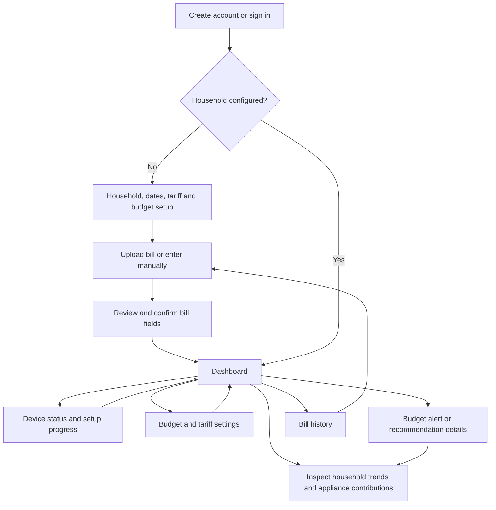

# WattWise — User Journey and Screen Requirements

**Status:** Local draft for team review; no application implementation or user testing claimed.  
**Prepared:** 28 October 2026  
**Task:** [#5 — Sketch the user journey and define screen requirements](https://github.com/AhmedISatti03/WattWise/issues/5)  
**Task owner:** Umut Topatan.  
**Proposed repository location:** `docs/frontend/screen-requirements.md`

## 1. Purpose and design basis

Agree how users navigate the MVP, what each screen communicates, and the data and states required for implementation. These wireframes specify content and hierarchy, not final branding or a chosen frontend framework.

Supporting deliverable: [screen-by-screen wireframes](wireframes.md). A separate [dashboard comparison image](wireframes/dashboard-overview.svg) shows desktop and phone arrangements.

Sources read for this draft:

- [MVP scope](https://github.com/AhmedISatti03/WattWise/blob/main/docs/mvp-scope.md): feature boundaries and measurement rules.
- [Energy display rules](https://github.com/AhmedISatti03/WattWise/blob/main/docs/energy-display-rules.md): labels, periods, examples, and initial forecast eligibility.
- [Insight scenarios](https://github.com/AhmedISatti03/WattWise/blob/main/docs/insight-scenarios.md): budget messages, recommendations, and unavailable-data behavior.
- [Collector plan](https://github.com/AhmedISatti03/WattWise/blob/main/docs/architecture/collector-plan.md): separate device, collector, and delivery states.
- [#3 — Sample electricity bills](https://github.com/AhmedISatti03/WattWise/issues/3): bill details remain provisional pending supplier/sample review.

Where the existing documents contain proposed product rules, this draft carries them forward without claiming team approval. Routes and view-data names below are proposals, not implemented API endpoints.

## 2. Main journey

First-time users are guided through setup and bill confirmation. They may choose **Finish later** for unavailable tariff, budget, bill, or hardware information and enter an honestly incomplete dashboard. Missing setup stays visible as a next step; it does not remove a mandatory MVP feature or mark setup complete.

Returning users land on the dashboard. A household with no readings sees setup guidance, not zero usage. A development sample household is explicitly separate from real pilot data.

## 3. Navigation and responsive behavior

| Destination | Proposed route | Desktop | Phone |
|---|---|---|---|
| Dashboard | `/dashboard` | Persistent sidebar | Bottom navigation: Home |
| Consumption detail | `/consumption` | Sidebar | Bottom navigation: Usage |
| Bills | `/bills` | Sidebar | Bottom navigation: Bills |
| Devices | `/devices` | Sidebar | Bottom navigation: Devices |
| Household, tariff, budget | `/settings` | Sidebar | Labelled header Settings button |
| Insight details | `/insights/:id` | Open from dashboard card | Open from dashboard card |
| Sign in / create account | `/sign-in`, `/register` | Public account screen | Same form in one column |

The household and billing cycle appear in the application header. Sign out is available through Settings. Reading an insight must not require navigating through Settings.

Proposed layout targets: desktop at 1024 px and above; stacked mobile/tablet content below that width. Check at 360 px, 390 px, 768 px, and 1440 px. Dashboard card order is preserved when stacked: data notice → household measurements → budget/forecast → trends → appliance contributions → recommendations. On phone the budget alert remains near the top, directly after household measurements. Long pages scroll vertically; tables become labelled cards. Charts fit the viewport and offer a textual data alternative.

## 4. Rules shared by all screens

- Every demonstration screen has a persistent **Sample data — not real household measurements** banner. Sample badges remain on readings and insights that may be viewed independently. Never mix sample totals into a real household.
- Distinguish **Measured**, **Calculated remainder**, **Estimated cost**, **Forecast**, **Historical bill**, and **User-set target** using text, not color alone.
- Use household timezone `Europe/Istanbul` for the pilot; label chart dates and billing boundaries. Show an explicit end-exclusive period in supporting details and a plain-language last included date in summaries.
- Display kWh and money to two decimal places; calculate using unrounded inputs. Power uses W or kW with reading time. Costs state included/excluded charges.
- Missing, loading, stale, and zero are different. A verified zero remains a valid value; an unavailable value displays an em dash plus a reason, never an automatic zero.
- Stale power becomes **Last recorded power**, with its time. Energy can remain usable across a communication gap only when backend validity checks support it.
- Household totals already contain appliance use. Contributions and other consumption are parts of the same total, never amounts added on top.
- Only display comparable appliance percentages and remainders when period and coverage checks pass. A negative remainder becomes **Other consumption unavailable — readings need checking**.
- Keep unaffected sections usable when another section fails. Preserve cached values with their original timestamps and a visible stale notice after refresh failure.
- Forms have persistent labels, associated inline error text, keyboard access, visible focus, and status announcements. Charts have summaries/data tables; color is supplemented with labels. Aim for 44 px touch controls and test keyboard/zoom behavior in implementation.
- No appliance switching, electrical-fault diagnosis, AI chat, native app, or guaranteed savings is introduced by these designs.

## 5. Screen requirements

### S01 — Account access

**Purpose:** Enter an account and access its own household.

**Content/actions:** Sign-in form, create-account link, email and password fields, show/hide password, submit, and a clear route back from registration. Proposed registration asks email, password, and confirmation. Password recovery is an unresolved authentication capability; do not expose a dead recovery link.

**Required data:** Session/authentication state; field validation rules; submission status; safe error code/message. Never include a password in returned display data or analytics.

**Behavior:** Sign-in returns to the requested permitted screen, or setup/dashboard as appropriate. Prevent repeated submits. Errors do not reveal whether an email belongs to an account. On session expiry, return to sign-in with an explanation; never repopulate passwords.

**States:** Initial empty form; submitting; invalid fields; incorrect credentials; network/server unavailable; success. No household information appears before authorization.

### S02 — Household setup

**Purpose:** Establish the household and calculation context before presenting meaningful costs.

**Content/actions:** Household name, timezone, billing-cycle start and end, supported tariff selection/manual tariff details, household budget in TRY, Save and continue, and Finish later for missing optional setup steps. Summarize whether devices and a confirmed bill are still missing.

**Required data:** Household ID/name/timezone; billing boundaries; supported tariff arrangement and effective dates; charge assumptions; budget and applicable cycle; field errors; saved/draft state. Exact tariff editor fields require the supported tariff decision.

**Validation:** End follows start; target is a valid positive monetary value when entered; supported tariff inputs pass their specific rules. Do not silently apply a flat rate or infer a verified tariff from OCR. An incomplete tariff suppresses dependent costs and forecasts while energy remains available.

**States:** New household; loading existing settings; validation error; saving; save failure with entries preserved; saved; incomplete setup with a named next action.

### S03 — Bill list and upload

**Purpose:** Add and retrieve historical bills without treating them as live readings.

**Content/actions:** Confirmed bill list with period, consumption, amount and historical label; Add bill; choose photo/PDF; visible supported-format and size guidance; selected file summary; Upload and review; Enter manually instead. File types and limits must come from actual backend capabilities before release.

**Required data:** Authorized bill summaries/IDs; accepted MIME types/extensions and byte limit; selected file name/size; upload/job ID and status; safe failure reason; supported supplier/layout description.

**Behavior:** Do not save OCR output as confirmed data automatically. Upload processing leads to S04. Detect possible duplicate bills and ask users to review the existing record before creating another. Resubmitting after a timeout must not create duplicate records. Do not put sensitive invoice images or personal details into logs or public fixtures.

**States:** No bills yet; list loading; list error with Retry; unsupported/oversized file; upload progress; processing; unreadable/unsupported layout; service failure; manual fallback. Show indeterminate progress when actual percentage is unknown. A cancel/retry UI must match backend capabilities rather than pretending a server job has stopped.

### S04 — Bill review and confirmation

**Purpose:** Let the user correct extracted fields and explicitly confirm historical data.

**Content/actions:** Reference preview where supported, editable extracted fields, highlights for missing/uncertain fields, Confirm and save, Back to upload, manual entry. Phone order is fields first with a labelled Show bill preview disclosure.

**Provisional fields pending #3:** Billing-period start/end; billed consumption (kWh); total invoice amount (TRY); supplier; tariff description; unit-rate/charge/tax breakdown where present. Supplier-specific names, mandatory fields, inclusive printed dates, tier handling, and OCR mappings require sample-bill inspection. Subscriber identifiers are not requested by default.

**Required data:** Extraction/job ID; per-field extracted value, origin and validation state; supported preview reference; corrected values; confirmation/save state; possible duplicate match. Show an OCR confidence number only if the service provides a meaningful, agreed value; otherwise mark **Check this field**.

**Validation:** Dates ordered; numeric fields parse reliably, including decimal separators; consumption and amounts nonnegative; required fields determined by the agreed supplier contract. Zero values trigger review when unusual rather than being universally prohibited. Confirmed bill consumption remains historical and does not fill live meter history automatically. Any tariff-setting update requires a separate explicit review.

**States:** Extracted draft; manual blank draft; missing/invalid fields; confirming; save failure with corrections retained; duplicate warning; confirmed success with link to dashboard/bill list. Unsaved navigation prompts the user before discarding changes.

### S05 — Dashboard

**Purpose:** Explain present household use, available spending estimates, appliance contributions, and actions.

**Content hierarchy:**

1. Household and billing cycle, sample/stale/coverage notices, and setup actions if needed.
2. Current household power and today's household energy, with time and quality labels.
3. Estimated household cost so far, full-cycle forecast, and same-cycle household budget.
4. Budget status/alert and explanation; link to consumption and budget settings.
5. Daily/weekly household trend with partial days and gaps labelled.
6. Appliance contributions and calculated other consumption over one matching period.
7. Explainable recommendations, each linked to its supporting details.

**Required data:** Household/timezone; selected billing cycle and chart period; per-metric value/unit/classification; observation/refresh time; coverage and gap reasons; forecast eligibility and valid-day count; forecast horizon, method/window and assumptions; budget; chart points with quality; matching appliance energy and shares; remainder validity; active insights and next actions. Forecast maturity and budget status are separate fields.

**Actions:** Change daily/weekly view; inspect consumption; open appliance detail; open device status; add missing tariff/budget/bill; open insight detail. A chart filter does not change the billing cycle used by the budget panel. On date changes, clear or visibly mark the previous period while loading; never relabel old data as the new period.

**Forecast behavior:** Carry forward #7's initial baseline: at least seven complete valid days within the cycle, valid tariff, and reliable elapsed-cycle energy. Show **3 of 7 complete days** for short history without promising an arrival date. Seven days alone does not fix missing earlier cycle data. Mark new forecasts **Early estimate** with its basis; the duration of that label remains an open decision.

**States:** Section skeletons; no readings; sample household; partial day; partial cycle; missing tariff; missing budget; insufficient history; individual device stale; household monitor stale; collector unreachable; one section fetch failed; complete page unavailable. Suppress only values whose necessary inputs are missing.

### S06 — Consumption and appliance detail

**Purpose:** Explain the period and evidence behind dashboard values and insight actions.

**Content/actions:** Household daily/weekly trend; named appliance selector; measured energy and status; matching household share when valid; recorded-period cost if calculable; coverage notes; table alternative; device-status link. Household and appliance headings remain explicit when switching.

**Required data:** Selected scope/device; period/timezone; valid chart points or interval totals; units; last observation; gap/coverage flags; tariff validity; cost classification/exclusions; denominator period and validity for shares.

**States:** Empty history; loading; failed fetch; partial period; disconnected device; incomparable periods; unavailable tariff. If counters establish total energy across a gap, show the supported total without fabricating hourly bars. A zero household denominator suppresses percentages.

### S07 — Device status

**Purpose:** Show which measurement source or delivery connection needs attention.

**Content/actions:** Whole-household monitor listed separately from 2–3 named plugs; source/sample label; device status; last measurement time; collector contact time; delivery status and last known pending count with timestamp; refresh; rename appliance association if supported; setup instructions for an unconfigured device.

**Required data:** Registered stable IDs, display names, scope/model, sample flag; per-device last valid reading/status/error reason; collector heartbeat/contact; timestamped queue/delivery summary; registration permissions. Do not expose access tokens, device passwords, or technical stack traces.

**Behavior:** Distinguish device unreachable, collector unreachable, and backend request failure. A disconnected plug need not invalidate household readings. A disconnected collector means local status is unknown, not proof every device is off. Refresh fetches status; it does not promise to repair connectivity. No control toggles or remote power switching.

**States:** No devices registered; awaiting first reading; reporting; stale/unreachable; setup/configuration error; collector last seen; upload delayed; stale status cache; status request failure. After reconnection, recovered energy depends on backend validation, not merely a green status icon.

### S08 — Household, tariff and budget settings

**Purpose:** Maintain calculation context and the target against which forecasts are compared.

**Content/actions:** Household/timezone section; billing dates; supported tariff details/effective period; budget amount and cycle; Save changes; Cancel; Sign out. Show **User-set target**, not a recommended spending allowance.

**Required data:** Persisted settings and version; editable fields; tariff schema; budget/cycle; validation/save state; revision conflict response; recalculation status for affected views.

**Behavior:** Validate as in setup. Do not reset the budget each calendar month if its cycle differs. Confirm changed tariff/dates and show that estimates will recalculate. Do not change historical measurements or previously confirmed bill amounts. Retain unsaved changes after failure, prevent duplicate saves, and handle edits from another session with a conflict message instead of silent overwriting.

**States:** Loading; missing tariff/budget; editing; invalid amount/date; saving; saved; save failed; conflicting revision; recalculation pending/error. Until revised estimates are ready, mark old outputs as using previous settings rather than combining an old forecast with a new budget status.

### S09 — Alert and recommendation details

**Purpose:** Explain why an insight appeared and offer a relevant, bounded action.

**Placement:** Dashboard budget card holds the current budget status and in-app warning. Recommendations appear below consumption/contribution sections. Both open a detail view with supporting period, inputs, assumptions, and action. No separate notification inbox is required by this draft.

**Required data:** Insight ID/type; current or historical state; household/cycle; generation time; headline/body; supporting values and quality; forecast/budget basis; recommended action target. Backend-generated eligibility and reasons govern whether an insight is supported.

**Behavior:** Already-incurred overspend takes precedence over forecast overspend, while a valid forecast stays separately visible. Do not repeat alerts on every refresh. When an old insight no longer applies, mark it **No longer current** on its detail view and link to current data. Re-entry/dismissal policy remains open; do not treat dismissal as a change to the underlying budget state.

**States:** Current; insufficient data; insight loading/error; no supported recommendations; no longer current. Cheaper-hour guidance requires a validated time-of-use tariff; a flat-rate configuration must not produce time-shifting cost claims. The largest monitored contributor is not necessarily the largest appliance in the home.

## 6. Required data summary for backend coordination

These are view-model groups, not a final database schema. All responses must be authorized to the account's household.

| Group | Required display inputs | Used by |
|---|---|---|
| Account/session | Signed-in state, permitted household, safe authentication failures | S01, app shell |
| Household configuration | ID, name, timezone, billing boundaries, setup completeness | S02, S05, S08 |
| Tariff/budget | Validity, effective dates, rate/charge rules and labels, budget, cycle, settings version | S02, S04, S05, S08 |
| Bill ingestion | Accepted formats/limits, job state, preview, provisional fields, errors, duplicate hint, confirmation | S03, S04 |
| Energy summary | Scope/device, period, value, unit, classification, last observation, coverage, failure reason | S05, S06 |
| Charts/contributions | Dated points, partial/gap markers, comparable appliance values, denominator, remainder validity | S05, S06 |
| Forecast/cost | Eligible flag/reasons, valid-day count, observed period, cycle coverage, method/window, assumptions, exclusions, generated time | S05, S06, S09 |
| Insights | Eligibility/state, supporting inputs, period, wording/action, currentness | S05, S09 |
| Device/collector status | Registered scopes, source kind, per-device last reading, backend contact, timestamped delivery health | S05 notices, S07 |
| Common metadata | Sample provenance, response/observation times, quality, recoverable error state | All data screens |

Use explicit unavailable reasons such as `no_readings`, `insufficient_valid_days`, `incomplete_cycle`, `tariff_missing`, `period_mismatch`, and `invalid_remainder`. Names are illustrative; agree the contract before coding. A null value without its reason is insufficient for useful UI messages.

## 7. Worked display fixtures

Every figure here is **synthetic sample data**. The fictional flat rate ₺3.00/kWh excludes additional charges; monetary fixtures must therefore say **Estimated energy cost**, not claim a complete utility invoice.

### Fixture A — Daily household and appliance view

For the complete sample day **27 October 2026, 00:00 to 28 October 00:00 (Europe/Istanbul)**:

| Item | Energy | Household share | Estimated energy cost |
|---|---:|---:|---:|
| Household total — measured | 12.00 kWh | 100% | ₺36.00 |
| AC — measured contribution | 4.00 kWh | 33.33% | ₺12.00 |
| Fridge — measured contribution | 1.00 kWh | 8.33% | ₺3.00 |
| Dishwasher — measured contribution | 2.00 kWh | 16.67% | ₺6.00 |
| Other — calculated remainder | 5.00 kWh | 41.67% | ₺15.00 |

The appliance total is 7.00 kWh within the 12.00 kWh household total. No 19.00 kWh combined total appears. Rounded shares need not sum exactly to 100% for every dataset. Other consumption is not a named appliance.

### Fixture B — Dashboard at a known sample time

Sample snapshot **28 October 2026 at 14:30 Europe/Istanbul**. Cycle: **18 October–16 November inclusive** (end-exclusive boundary: 17 November 00:00); 30 calendar days.

- Current household power: **820 W**, measured at 14:30.
- Today's household energy: **8.40 kWh**, 00:00–14:30, labelled **Today — partial day**. Complete coverage so far does not make it a complete day.
- Prior 10 complete cycle days: **100.00 kWh**; today adds 8.40 kWh; valid recorded cycle total: **108.40 kWh**.
- Latest seven complete days: **70.00 kWh**, averaging 10.00 kWh/day. Remaining period: **19 days + 9.5 hours**; precise handling of partial-day extrapolation must be agreed before implementing intraday forecasts.
- To avoid inventing that rule, the budget panel explicitly displays the **last calculated forecast at 28 October 00:00**: 100 + (20 × 10) = **300.00 kWh**, estimated full-cycle energy cost **₺900.00**. Its explanation says it uses data through 27 October. It is not labelled a freshly calculated 14:30 forecast.
- Estimated recorded energy cost so far: **₺325.20** (108.40 × 3), labelled as current through 14:30.
- Household budget: **₺800.00** for that same cycle; projected overspend from the dated forecast: **₺100.00**.
- Forecast explanatory text: **Early estimate. Based on seven complete days; assumes recent usage continues. Energy charges only; excludes other invoice charges. Last calculated 28 October, 00:00.**
- Contribution panel selects **Yesterday, 27 October**, using Fixture A. Its different date is explicit; these are not presented as today's shares.

### Fixture C — Insufficient history and partial-cycle data

- With three complete valid days: **3 of 7 complete days collected**; no numerical forecast or forecast-based on-track claim.
- With 50.00 kWh measured only on cycle days 11–15: show **Recorded energy, days 11–15: 50.00 kWh** and **Estimated energy cost for this observed period: ₺150.00**. Earlier cycle data is missing, so the full-cycle forecast remains unavailable even if seven later days eventually exist.
- Keep the configured budget visible with **Forecast unavailable**. Reliable known costs can still establish an already-exceeded warning where they exceed the target.

### Fixture D — Device and comparison failure

- Fridge plug last observed at 14:20: show **Last recorded power**, its timestamp, and stale status once the agreed threshold is passed.
- If fridge interval energy is incomplete, withhold its full-period share and the remainder; keep valid household totals and eligible household forecast.
- If appliance readings total 13.00 kWh against household 12.00 kWh for an allegedly matching period: show **Other consumption unavailable — readings need checking** rather than −1.00 kWh or zero.
- If the API fails, display **Could not refresh** with the original observation time. Do not claim the physical device is disconnected solely because a page request failed.

## 8. Cross-screen state and recovery matrix

| Situation | User sees | Recovery/action |
|---|---|---|
| First visit, no readings | No household readings yet; setup progress | Open Devices; no fake 0 kWh |
| Data loading | Labelled skeleton/status | Preserve layout; prevent conflicting submits |
| Network request fails | Scoped failure and optional last-known value/time | Retry that section; retain form input |
| Device disconnects | Named source, last measured time, affected coverage | View Devices; retain unaffected values |
| Collector unreachable | Last backend contact; local device state unknown | Check collector/network; no claim every appliance is off |
| Missing tariff | Energy remains visible; cost/forecast reason | Open tariff settings |
| Missing budget | Valid forecast can remain; no budget status | Set target |
| Bill OCR fails | Extraction unavailable; historical input not saved | Retry upload or enter manually |
| Save times out | Uncertain save status; preserve draft | Check operation result before retrying duplicate creation |
| Session expires | Sign-in required | Reauthenticate; server retains authorized draft only if supported; no sensitive browser-storage assumption |
| No applicable advice | No recommendations available for this data | Continue viewing consumption; no invented advice |
| Sample data | Persistent sample banner and provenance | Use separate real household when ready |

## 9. Open decisions and handoff

| Decision | Refinement needed |
|---|---|
| Bill schema after #3 | Supplier, exact printed fields, required confirmation fields, supported layout, date interpretation, privacy/retention. |
| Authentication | Password policy, recovery, verification, session handling; avoid adding unsupported account flows. |
| Tariff editor | Validated tariff structure, effective dates, taxes/charges, allocation assumptions, permitted edits. |
| Forecast presentation | Confirm seven-day rule, early-label exit conditions, update frequency, intraday handling, and freshness limit for budget status. |
| Status thresholds | Align stale reading/collector thresholds with tested collector behavior; existing plan proposes 30 s and 180 s respectively. |
| Insights | Alert repeat/re-entry behavior, currentness, safe recommendation rules; use the scenario document as baseline. |
| Device setup | Registration/association capability and who provisions it; no automatic discovery or browser-to-device access assumed. |
| Language | Wireframes use English and TRY; confirm interface language and number formatting before implementation. |
| Implementation | Choose frontend stack, API contract, upload limits, accessibility checks and component tests separately. |

Ahmed reviews scope, labels, measurement meaning and insights. Umut owns this task, defines the screen requirements and wireframes, and checks the data contracts. Team review remains pending.

## 10. Review against task #5

| Acceptance item | Evidence in this deliverable | Status |
|---|---|---|
| Main journey understandable | Section 2; W01 journey; W02–W10 screen sketches | Prepared for review |
| Required screen data/interactions listed | Sections 5–6 | Prepared for review |
| Failure and empty states included | Per-screen states, section 8, W11 variants | Prepared for review |
| Household and appliance totals distinct | Shared rules, Fixtures A/B/D, W06/W07 hierarchy | Prepared for review |
| Desktop and phone dashboard shown | W06/W07 plus SVG comparison | Prepared for review |
| Bill uncertainties marked | S04 and section 9; #3 still open | Pending refinement, not blocking initial sketches |

