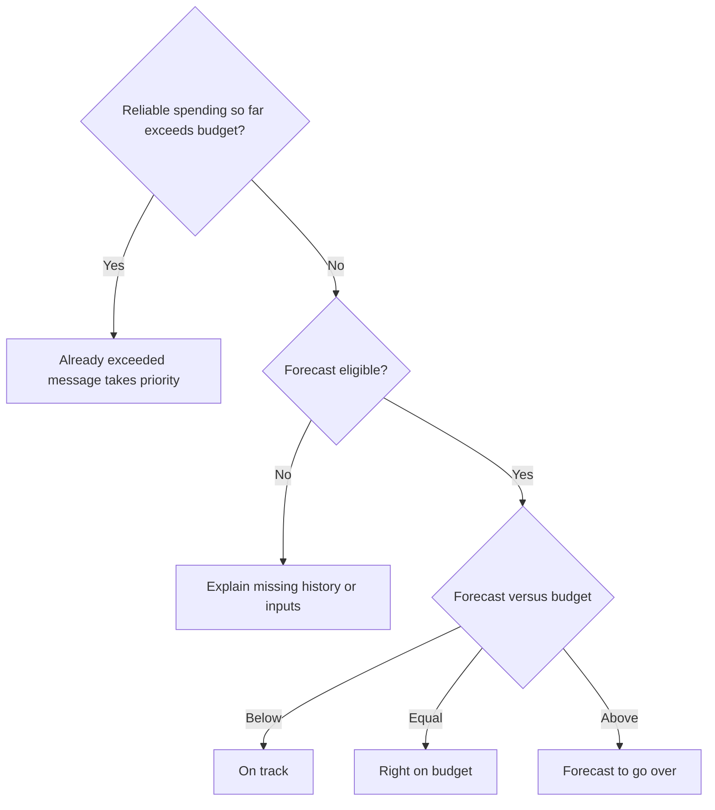

# WattWise — Insight Scenarios

**Status:** Draft for review · **Task:** #10 · **Date:** 24 October 2026  
**Intended repository path:** `docs/insight-scenarios.md`  
**References:** MVP scope and `docs/energy-display-rules.md` (task #7).

## Purpose and common rules

Define reproducible examples of forecasts, budget messages and recommendations for frontend and backend development. This document specifies observable behaviour, not API structures or detailed visual design.

**All figures, tariff rates and hours below are synthetic sample data. They do not demonstrate forecast accuracy.** Monetary examples use a fictional flat ₺3.00/kWh unless stated otherwise.

- Compare values for the same household and billing cycle. Never add appliance totals to household consumption.
- Separate measured energy, estimated spending and future forecasts. Missing readings never become zero.
- Use encouraging headlines, clear numbers and honest explanations. Do not imply guaranteed savings, improved habits or electrical faults without evidence.
- A forecast requires valid tariff inputs, at least seven complete valid days and adequate elapsed-cycle energy coverage under task #7's baseline.
- Forecast maturity, budget status and device availability are separate dimensions: an early estimate can be above or below budget while an appliance is offline.

## Decision overview

Even when the already-exceeded message takes priority, show a valid end-of-cycle forecast separately. If it is unavailable, explain why. Early-estimate and data-quality notices accompany relevant states.

## Scenario 1 — Forecast within budget

**Purpose:** Encourage the user while accurately describing projected budget headroom.

| Item | Definition / sample |
|---|---|
| Inputs | Valid full-cycle forecast ₺720; same-cycle budget ₺800 |
| Trigger | Forecast is below budget and no reliable already-exceeded condition takes priority |
| Expected calculation | ₺800 − ₺720 = ₺80 projected headroom |
| Placement | Dashboard budget section; no repeated congratulatory notifications |

> 🌱 **You’re on track!**  
> Your estimated bill is **₺720**—that’s **₺80 below your ₺800 budget**.  
> *Based on your recent usage; your estimate may change.*

**Exceptions:** At equality, show **“You’re right on your budget.”** Headroom is not achieved savings. Do not praise reduced consumption without a valid comparison. Missing forecast or budget suppresses this status.

**Acceptance checks**

- [ ] Figures and headroom match the inputs and billing cycle.
- [ ] Equality produces the equality message, not positive headroom.
- [ ] No positive forecast-based status appears when required inputs are unavailable.

## Scenario 2 — Projected versus already-incurred overspending

**Purpose:** Clearly distinguish future risk from a budget already exceeded by estimated recorded costs.

| Case | Inputs | Expected output |
|---|---|---|
| Predicted overspend | Spending so far ₺300; forecast ₺900; budget ₺800 | ₺100 projected overspend |
| Already exceeded | Spending so far ₺820; budget ₺800; cycle ongoing | ₺20 already above budget |

> 💡 **You’re forecast to go over budget**  
> Your estimated spending so far is **₺300**, within your **₺800 budget**. At your current pace, your bill could reach **₺900** by the end of this billing cycle—**₺100 over budget**.  
> There’s still time to adjust your usage.  
> **Action: View consumption**

> **You’ve already passed your budget**  
> Your estimated spending so far is **₺820**—already **₺20 above your ₺800 budget**, with the billing cycle still ongoing.  
> Reducing usage now can help limit further costs.  
> **Action: View consumption**

Both messages include: *Costs are estimates based on available readings and your configured tariff.*

**Behaviour:** Show the already-exceeded message first when both apply. Present a valid forecast separately. Produce an in-app alert when entering the forecast-over-budget state, without duplicates on every refresh. Do not imply past costs can be undone or guarantee returning below budget.

**Exceptions:** An unreliable forecast suppresses forecast-based warnings. Reliable recorded costs already above budget can still support the already-exceeded warning. With partial records, use this only when known valid costs establish the exceedance; clearly identify incomplete coverage.

**Acceptance checks**

- [ ] Both overspend amounts reproduce correctly.
- [ ] The already-exceeded state takes priority when applicable.
- [ ] Refreshing unchanged data does not repeat the alert.
- [ ] Unsupported forecast warnings and appliance blame are suppressed.

## Scenario 3 — Insufficient history

| Item | Definition / sample |
|---|---|
| Trigger | Fewer than seven complete valid days |
| Inputs | Three complete valid days; other readings may be partial |
| Output | 3 of 7 progress; no numerical forecast |
| Keep visible | Available power, recorded energy, observed-period estimated costs and configured budget |

> 🌱 **We’re getting to know your home**  
> We’ve collected **3 of the 7 complete days** needed to start estimating your bill. Your forecast will appear once enough readings are available and your billing-period coverage is complete.  
> You can already explore your recorded consumption and estimated costs.  
> **Action: View consumption**

**Exceptions:** Incomplete days do not count. Do not promise a fixed forecast arrival date. Seven days alone do not resolve missing earlier billing-cycle energy or missing tariffs. No forecast-based on-track/overspend message appears; reliable already-incurred overspending can still be reported.

**Acceptance checks**

- [ ] Three valid days displays 3 of 7, excluding incomplete days.
- [ ] Forecast remains unavailable until all eligibility conditions are satisfied.
- [ ] Observed-period cost is not presented as complete cycle-to-date cost.

## Scenario 4 — Early estimate and changing usage

**Purpose:** Explain the evidence and limitations of a newly available forecast. This is a maturity notice, not a separate budget status.

| Input | Sample |
|---|---:|
| Billing cycle | 30 days; first 10 complete days recorded |
| Recorded cycle energy | 100 kWh |
| Latest seven complete days | 70 kWh → 10 kWh/day |
| Remaining period | 20 days → 200 kWh forecast |
| Full-cycle forecast | 300 kWh → ₺900 |

> 🌱 **Your first estimate is ready**  
> **Early estimate: ₺900**  
> Based on 7 complete days of recent usage. This estimate assumes your recent usage continues and may change as more readings become available.  
> **Recent usage window:** 7 complete days · **Cycle coverage:** 10 of 30 days recorded · **Last updated:** show timestamp

**Behaviour and exceptions**

- Show the usage window, cycle coverage, last-update time and relevant limitations alongside the estimate.
- More collected history does not automatically mean improved accuracy. The current baseline uses the latest seven complete valid days; later in the cycle, less consumption remains to predict.
- Keep genuine high-usage readings. One unusual week may reflect guests, weather or a changed routine; do not automatically treat it as faulty data.
- Flag suspected invalid readings, counter-reset artefacts or duplicates. Withhold the forecast when essential inputs cannot be established reliably.
- Explain significant changes where supported, without inventing a cause or repeatedly alerting on fluctuations.
- Do not display unvalidated confidence percentages, arbitrary uncertainty ranges or guaranteed accuracy.

**Sensitivity example:** Six days at 10 kWh plus one at 30 kWh average 12.86 kWh/day. Extrapolating the unrounded average across 23 remaining days gives approximately 295.71 kWh. If actual future use returns to 10 kWh/day, it is 230 kWh—a difference of approximately 65.71 kWh. This illustrates sensitivity, not measured forecast performance.

**Acceptance checks**

- [ ] The baseline reproduces 300 kWh and ₺900 in the primary sample.
- [ ] Early-estimate information can coexist with either budget status.
- [ ] Valid high-use days are not silently removed.
- [ ] Unreliable essential inputs suppress the forecast with an explanation.

## Scenario 5 — Missing or partial measurements

| Case / inputs | Expected behaviour |
|---|---|
| Fridge plug stale; last reading 14:20; household data reliable | Mark fridge stale/partial; keep household values and eligible household forecast |
| Household elapsed-cycle energy genuinely missing | Mark recorded totals partial; withhold full-cycle forecast under the baseline |
| Appliance and household periods cannot be compared reliably | Withhold the affected appliance percentage and calculated remainder |
| Valid cumulative counters bridge a transmission gap | Recover supported interval energy only; do not invent hourly detail |

> 🔌 **We haven’t heard from your fridge plug recently**  
> Last reading received at **14:20**. Your household readings are still available, but the fridge’s consumption may be incomplete.  
> Check that the plug has power and a Wi-Fi connection.  
> **Action: View device status**

> **Your bill estimate is temporarily unavailable**  
> Some household readings are missing from this billing cycle. You can still view your recorded consumption while we check for recovered data.

**Recovery:** Reconnection alone does not prove recovery of missing energy. Restore only verified values. Label stale power as last recorded power, not current power. Missing data is never zero.

**Acceptance checks**

- [ ] Only dependent values are withheld; unaffected information remains visible.
- [ ] Device identity, last-update time and partial coverage are clear.
- [ ] Recovered energy totals do not imply a recovered hourly pattern.

## Scenario 6 — Monitored-appliance contribution

| Item | Definition / sample |
|---|---|
| Inputs | Matching, reliable daily readings: household 12 kWh; AC 4; fridge 1; dishwasher 2 |
| Trigger | Identify the largest energy contributor among monitored appliances |
| Output | AC is largest monitored contributor; 4 ÷ 12 × 100 ≈ 33% of household energy |
| Remainder | 12 − 4 − 1 − 2 = 5 kWh; calculated, not an identified appliance |

> 💡 **A closer look at your AC usage**  
> Your AC used **4 kWh today**, accounting for **33% of your recorded household consumption**.  
> If comfortable, consider reducing its running time when the room is unoccupied.  
> **Action: View AC usage**

**Exceptions:** Largest monitored contributor does not mean largest appliance in the whole home. High contribution alone does not prove waste, a fault or responsibility for the entire overspend. Suggestions must suit the appliance; do not recommend interrupting essential operation. Withhold unreliable shares or shares with a zero denominator. Handle impossible comparisons as data-quality issues.

**Acceptance checks**

- [ ] Share rounds to 33%; household total remains 12 kWh.
- [ ] Missing/nonmatching readings suppress unsupported shares.
- [ ] No guaranteed saving, fault diagnosis or unsupported overspend attribution appears.

## Scenario 7 — Cheaper-hour scheduling

| Item | Definition / sample |
|---|---|
| Inputs | Fictional validated example tariff: ₺4/kWh outside 22:00–06:00; ₺2/kWh inside that window; household local time |
| Trigger | Configured tariff has a cheaper period and the activity is suitable for optional rescheduling |
| Output | State the actual cheaper hours/rate and offer scheduling advice |
| Flat-rate alternative | No cost-saving claim from shifting the time of use |

> 🕒 **A different time could cost less**  
> Your tariff offers a lower electricity rate between **22:00 and 06:00** (**₺2/kWh**, compared with **₺4/kWh** outside this period). If convenient, consider scheduling your dishwasher within that period.  
> *Savings depend on how much electricity is used during the cheaper hours.*  
> **Action: View tariff details**

**Exceptions:** Hours and rates are illustrative only. Use the actual supported tariff, not assumed national peak hours. Personalise claims about current appliance timing only with supporting readings. Shifting time may reduce cost without reducing energy. Do not promise a saving amount without enough inputs. This is advice, not automatic switching.

**Acceptance checks**

- [ ] Displayed hours and rates match the configured example tariff and timezone.
- [ ] A flat-rate tariff suppresses cheaper-hour cost-saving recommendations.
- [ ] No unsupported appliance-timing or savings claim appears.

## Implementation decisions to finalise separately

These do not change the agreed overview; implementation must define and test them before release:

- Device-specific stale-reading limits and energy-coverage validity checks.
- Duration/exit criteria for the early-estimate label; thresholds for significant forecast changes.
- Alert re-entry, repeat suppression and budget-edit behaviour; consistent money-comparison rounding.
- Recommendation suitability rules and treatment of ties among monitored contributors.
- Forecast evaluation: retain dated predictions, compare with observed outcomes, and assess error at comparable forecast horizons before making accuracy claims.
